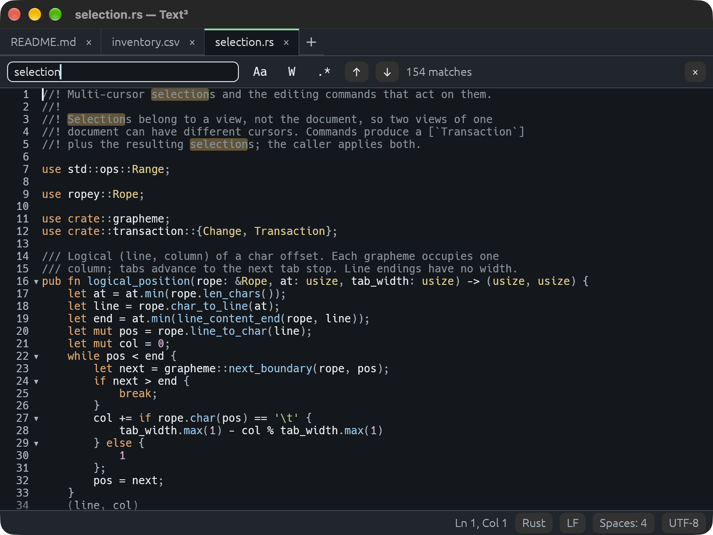
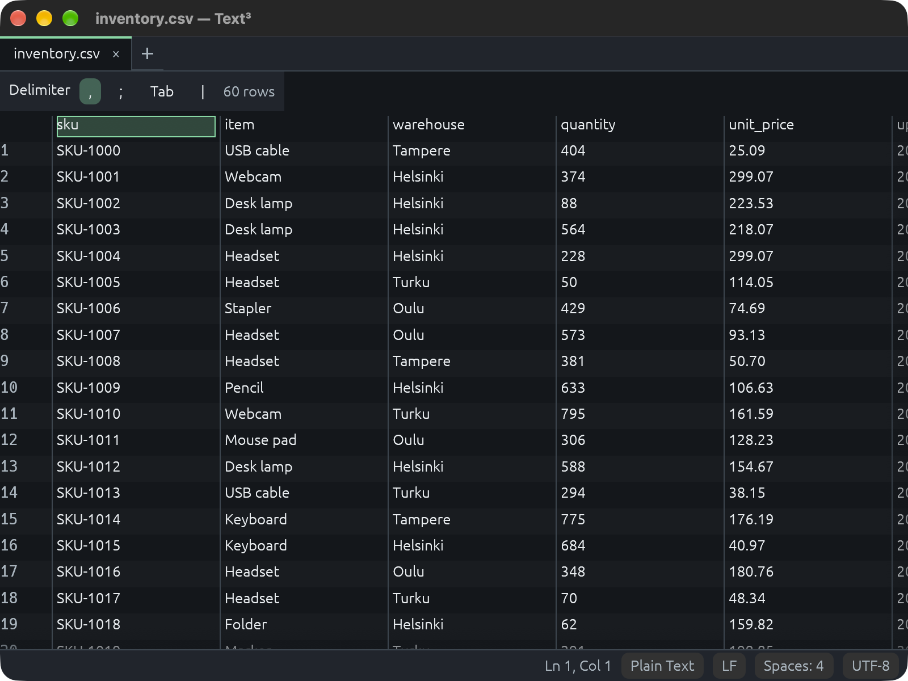
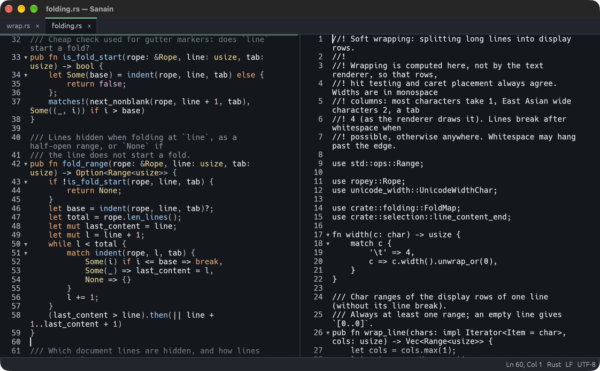
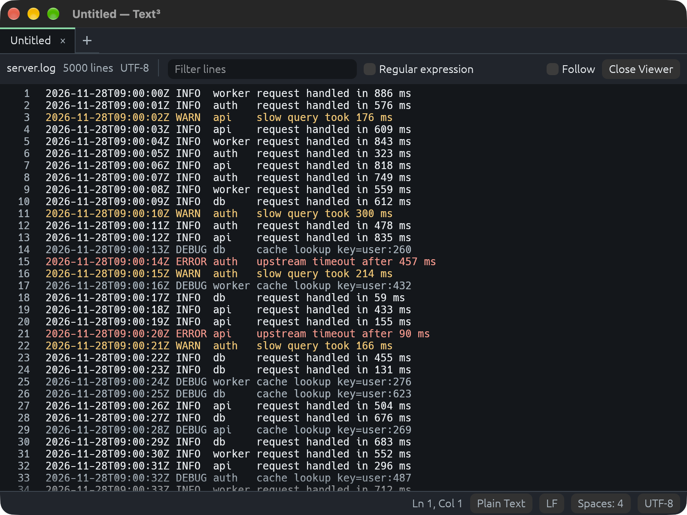

# Sanain
**The power of words.**

A native, open-source text editor for everyday text, code, configuration
files, Markdown and data. Written in Rust for Windows, macOS and Linux.
Fast by design. Powerful when needed. Simple by default.

> **Status: pre-alpha (0.0.1).** There are no downloadable releases yet;
> build from source to try it. Tested by hand on macOS; Windows and Linux
> are built and tested in CI but not yet tried interactively.

## What works today

- **Editing:** tabs (drag to reorder, pin, close others), a split editor,
  multiple cursors (Option/Alt+click, Option/Alt+drag for a column
  selection, Add Cursor Above/Below, Select Next and Skip Occurrence,
  move tabs from the keyboard), automatic
  indentation, indent/outdent and line comments, bracket matching, word
  and line operations, undo/redo, keyboard macros (also run many times
  in one undo step), word wrap, code
  folding, Go to Line and Go to Heading, command palette
  (Cmd/Ctrl+Shift+P).
- **Find:** find and replace with regular expressions, a preview before
  Replace All, search across a folder, and Replace in Files (after a
  confirmation; open files change in their tab, the others keep their
  previous version in local history).
- **Your files stay intact:** unchanged files save byte for byte, line
  endings and encodings are preserved, saves are atomic, and Sanain refuses
  to overwrite a file another program changed. A full disk or a missing
  permission is explained and leaves the file untouched. Unsaved text
  survives a crash and comes back on the next launch. Hard-linked files
  stay linked when saved (macOS, Linux). Local history keeps
  earlier saved versions on your computer so you can restore them, and
  any file can be compared with its saved version.
- **Files:** Open Recent, Save All, Revert to Saved, drag and drop,
  Copy File Path, Show in Finder/Explorer. Command line:
  `sanain FILE…`, `sanain --diff LEFT RIGHT`, `--help`.
- **Encodings:** UTF-8 and UTF-16 (with or without a byte order mark,
  detected), plus legacy encodings such as Windows-1252, ISO-8859-15 and
  Shift_JIS, suggested from the file's contents and used only when they
  reproduce the file exactly.
- **Markdown:** source, split and preview, with tables, task lists,
  coloured code blocks, local images and safe links, plus an Outline
  panel. Nothing in a document runs or loads from the network.
- **Data files:** syntax highlighting for 18 languages, JSON
  validate/format/minify that keeps your numbers and keys as written,
  XML and YAML validation, read-only trees for JSON, XML and YAML
  (entities and aliases are never expanded), a CSV grid, side-by-side
  comparison with another tab, any file, the saved version or the
  clipboard (changed characters highlighted, whitespace optionally
  ignored), and text tools (sort, deduplicate,
  case, line endings).
- **Large files and logs:** a read-only log viewer for files of any size,
  with level colours, filtering, Go to Line and follow mode, in UTF-8 or
  legacy encodings; files of
  256 MB or more open there automatically. Very long lines (minified
  files) stay responsive.
- **Comfort:** light, dark and high-contrast themes, zoom, session restore,
  configurable shortcuts with a Notepad++ preset, native macOS menus.
- **Languages:** the interface is available in 26 languages. English is
  the reference; Finnish is a draft; the other 24 are machine
  translations awaiting review by native speakers. Corrections are
  welcome (see [docs/LOCALIZATION.md](docs/LOCALIZATION.md)).
- **Updates:** Check for Updates asks GitHub whether a newer release
  exists and links to it. A daily check can be turned on in Settings; it
  is off by default. Sanain never downloads or installs anything itself.

| Markdown split view | Find and replace |
|---|---|
|  |  |
| **CSV grid** | **Light theme** |
|  |  |
| **Split editor** | **Log viewer** |
|  |  |

Screenshots are from a real build (macOS, release profile).

## Principles

Offline by default. No accounts, ads or telemetry. All features are free.
File contents never leave your computer unless you choose a feature that
says otherwise. See [PRIVACY.md](PRIVACY.md).

## Packages

`scripts/package.py` builds an unsigned archive for the current platform
(macOS `Sanain.app`, Windows zip, Linux tar.gz) with the license,
third-party notices and a checksum; the `Package` workflow builds all
three. No release has been published yet.

## Building

Requires Rust via [rustup](https://rustup.rs); the toolchain version is
pinned in `rust-toolchain.toml`.

    cargo run --release -p sanain-app -- path/to/file.txt

On macOS, build and open the app bundle (correct app name and menu bar):

    scripts/macos-bundle.sh release --open path/to/file.txt

Run the checks used in CI:

    cargo fmt --all -- --check
    cargo clippy --workspace --all-targets --locked -- -D warnings
    cargo test --workspace --locked

## How Sanain is made

**AI-built. Human-led. Community-driven.** Claude, an AI model by
Anthropic, writes and maintains the code, tests and documentation under the
direction of the project's founder. Human contributions are welcome; see
[CONTRIBUTING.md](CONTRIBUTING.md). We disclose AI involvement accurately
and do not claim that dependencies or community patches are AI-written.

Progress and plans: [docs/STATUS.md](docs/STATUS.md),
[docs/ROADMAP.md](docs/ROADMAP.md). Security reports:
[SECURITY.md](SECURITY.md).

## License

**Free. Forever. For everyone.** Mozilla Public License 2.0. See
[LICENSE](LICENSE).
