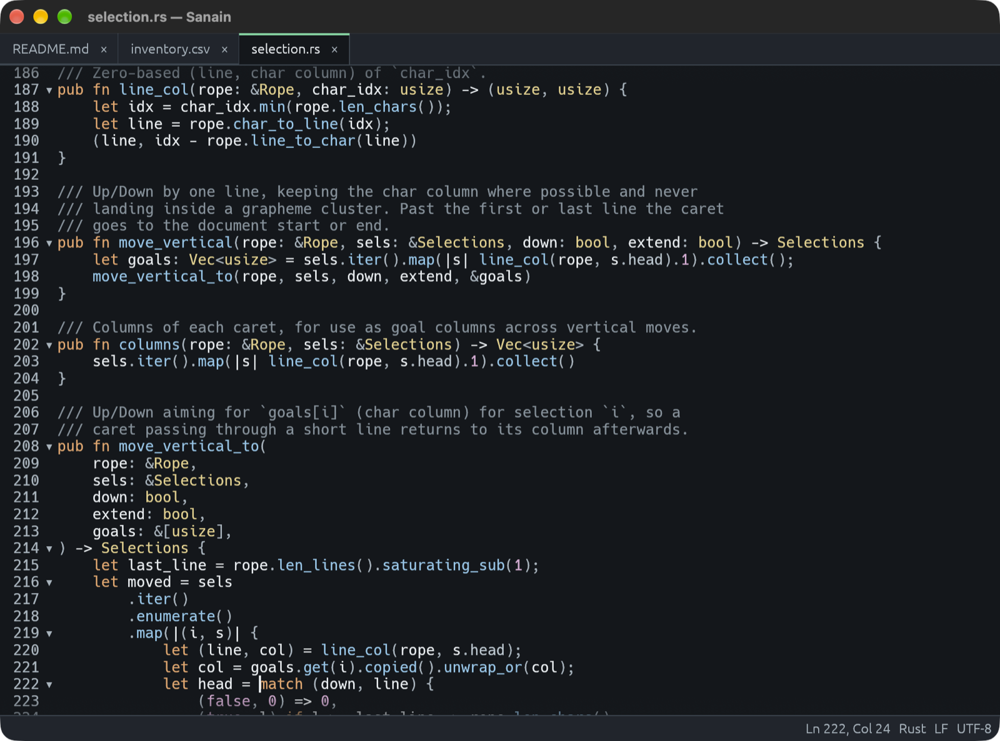
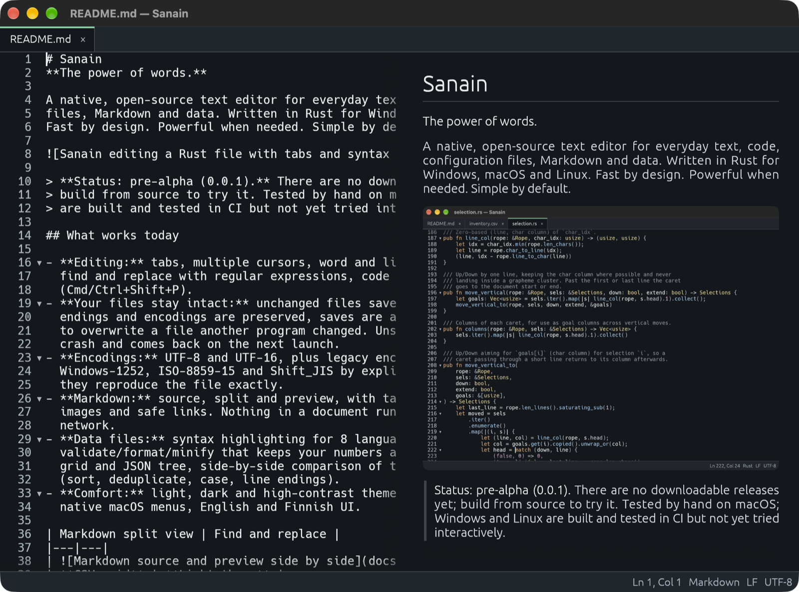
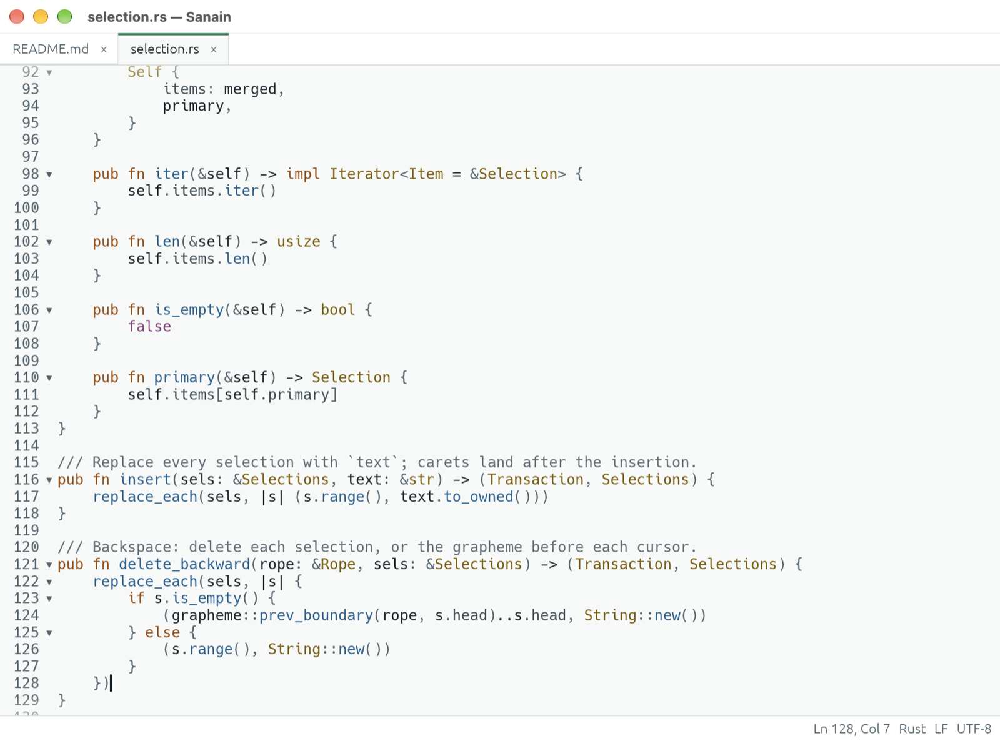

# Sanain
**The power of words.**

A native, open-source text editor for everyday text, code, configuration
files, Markdown and data. Written in Rust for Windows, macOS and Linux.
Fast by design. Powerful when needed. Simple by default.

> **Status: pre-alpha (0.0.1).** There are no downloadable releases yet;
> build from source to try it. Tested by hand on macOS; Windows and Linux
> are built and tested in CI but not yet tried interactively.

## What works today

- **Editing:** tabs, multiple cursors, word and line operations, undo/redo,
  find and replace with regular expressions, code folding, command palette
  (Cmd/Ctrl+Shift+P).
- **Your files stay intact:** unchanged files save byte for byte, line
  endings and encodings are preserved, saves are atomic, and Sanain refuses
  to overwrite a file another program changed. Unsaved text survives a
  crash and comes back on the next launch.
- **Encodings:** UTF-8 and UTF-16, plus legacy encodings such as
  Windows-1252, ISO-8859-15 and Shift_JIS by explicit choice, only when
  they reproduce the file exactly.
- **Markdown:** source, split and preview, with tables, task lists, local
  images and safe links. Nothing in a document runs or loads from the
  network.
- **Data files:** syntax highlighting for 8 languages, JSON
  validate/format/minify that keeps your numbers and keys as written, a CSV
  grid and JSON tree, side-by-side comparison of two files, and text tools
  (sort, deduplicate, case, line endings).
- **Comfort:** light, dark and high-contrast themes, zoom, session restore,
  native macOS menus, English and Finnish UI.

| Markdown split view | Find and replace |
|---|---|
|  |  |
| **CSV grid** | **Light theme** |
|  |  |

Screenshots are from a real build (macOS, release profile).

## Principles

Offline by default. No accounts, ads or telemetry. All features are free.
File contents never leave your computer unless you choose a feature that
says otherwise. See [PRIVACY.md](PRIVACY.md).

## Building

Requires Rust via [rustup](https://rustup.rs); the toolchain version is
pinned in `rust-toolchain.toml`.

    cargo run --release -p sanain-app -- path/to/file.txt

On macOS, build and open the app bundle (correct app name and menu bar):

    scripts/macos-bundle.sh release --open path/to/file.txt

Run the checks used in CI:

    cargo fmt --all -- --check
    cargo clippy --workspace --all-targets --locked -- -D warnings
    cargo test --workspace --locked

## How Sanain is made

**AI-built. Human-led. Community-driven.** Claude, an AI model by
Anthropic, writes and maintains the code, tests and documentation under the
direction of the project's founder. Human contributions are welcome; see
[CONTRIBUTING.md](CONTRIBUTING.md). We disclose AI involvement accurately
and do not claim that dependencies or community patches are AI-written.

Progress and plans: [docs/STATUS.md](docs/STATUS.md),
[docs/ROADMAP.md](docs/ROADMAP.md). Security reports:
[SECURITY.md](SECURITY.md).

## License

**Free. Forever. For everyone.** Mozilla Public License 2.0. See
[LICENSE](LICENSE).
