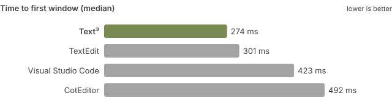
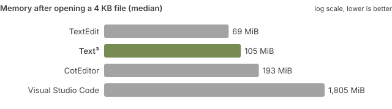

# Performance

Lightness and speed are the point of Text³ (docs/QUALITY_GATES.md, G2).
This page is generated by `scripts/bench/report.py` from the measured
results in `bench/results/`; every number comes from a real run, with
the machine, versions and method beside it. Run the measurements
yourself with the scripts named below.

## Compared with other editors (2026-11-28)

macOS 27.2.1, Apple M5, 24 GB. Text³ commit `576262a`. Method: `scripts/bench/compare.py`: each app opens the same 4 KB plain text file through Launch Services (`open -n -a`, as a double-click does), 10 alternating runs after one warm-up, scratch profiles. *Window* is the time until the app's first window is on screen (window server, polled every millisecond; no in-app probe). *Memory* is the resident memory of all the app's processes after 5 s idle. *Size* is the app bundle on disk.

| App | Version | Window, median / p95 | Memory, median | App size |
|---|---|---|---|---|
| **Text³** | 0.2.1 | 274 / 466 ms | 105 MiB | 44 MiB |
| TextEdit | 1.21 | 301 / 331 ms | 69 MiB | 2 MiB |
| Visual Studio Code | 1.138.0 | 423 / 565 ms | 1805 MiB | 1458 MiB |
| CotEditor | 7.1.3 | 492 / 551 ms | 193 MiB | 122 MiB |

Not measured on this machine (not installed): Sublime Text, Zed, BBEdit.

Machine load average at the end of the run: 6.4. Window time is not the same as the file's text being drawn: it is the one point that can be measured the same way for every app. TextEdit is part of macOS, so its libraries are already loaded and shared, which keeps its size and memory small.

## Over time

Text³'s own start-up and memory per change are in docs/BENCHMARKS.md
(`scripts/measure-startup.py`, which uses the in-app start-up probe and
compares against the previous build). Each new comparison run adds a
results file here, so the history accumulates with the code.

## Not measured yet

- Windows (Notepad++, Sublime Text, VS Code) and Linux: planned on
  throwaway CI runners, so no third-party program is installed on a
  developer's own machine.
- Large files (100 MB), typing latency and search speed across editors.
